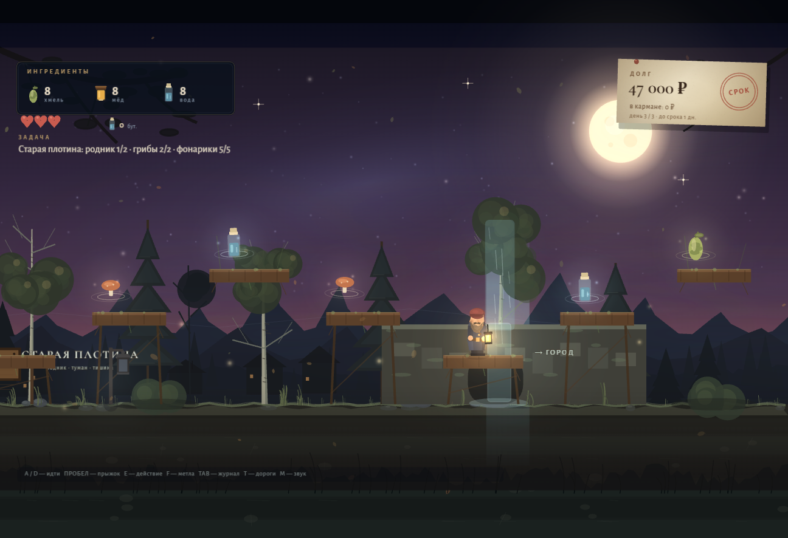

# Дядя Витя и тихий берег

**Атмосферная история в пяти главах: платформер, пивоварня, долги и один очень тихий берег.**

Дядя Витя три года не пьёт, но должен Борисычу сорок семь тысяч. На двери — записка «Три дня». В сарае — отцовский медный чан, а в старой тетради — рецепт медовухи. Значит, пора варить. А потом — фестиваль, городской заказ и старая плотина, о которой лучше не молчать.

**▶ Играть онлайн: [yakimak.github.io/dyadya-vitya](https://yakimak.github.io/dyadya-vitya/)**
Играть можно прямо в браузере, скачивать ничего не нужно. Одно прохождение — примерно **40–60 минут**, если не спешить и помогать людям.


## Что это теперь

- **Пять глав.** Долг, старая мельница, настоящий деревенский фестиваль, городской заказ и старая плотина.
- **Один большой мир:** двор и огород, яблоневый сад, река, хмелевая роща, пивоварня, лесная дорога со старой мельницей, площадь «Тихий берег» и новая зона — старая плотина с родником.
- **Обучение метле.** У хмелевой рощи стоит тренировочное чучело: три удара, понятная подсказка и награда. Если пропустить — обучение повторится перед обороной пивоварни.
- **Настоящий фестиваль.** На площадь приходят все: Баба Зина, Стас, Гриша, Пал Палыч, Клава, Борисыч и городской покупатель Аркадий. Толпа, столы, гирлянды, фонарики, музыка и фейерверк.
- **Фонарики как маленький квест.** Пять фонариков висят на площадках и у сцены. Зажгите их — площадь станет светлее, а приз больше.
- **Глубокая варка.** У каждого напитка свой процесс, а не три одинаковые полоски:
  - **Медовуха** — развод мёда, дрожжи, подкормка, тихое брожение.
  - **Пиво «Отцовское»** — затирание солода, три добавки хмеля, промывка, ферментация.
  - **«Зимний берег»** — настой ягод, пряности, брожение, осветление.
  - **«Плотинный стаут»** — копчёный солод, хмель, родниковая вода, брожение и снятие с осадка.
- **Разные механики варки:** баланс плотности, удержание температуры в зоне, точные добавки по таймингу и решение о моменте. Качество влияет на цену и на то, примет ли заказ город.
- **Пять рецептов** и четыре разных производственных процесса.
- **Городской заказ.** После фестиваля Аркадий просит три свежие бочки, а затем — стаут на воде со старой плотины. Это ещё один полноценный акт игры.
- **Новая зона «Старая плотина»:** родник, туман, руины, платформы, редкие грибы и родниковая вода.
- **Экономика:** варите партии, продавайте бутылки, платите Борисычу, покупайте улучшения.
- **Поручения:** огород с хмелем, счастливая блесна Стаса, фонарик Гриши, оборона пивоварни, фонарики на фестивале.
- **Бой:** метла, сердца, вороны-воришки и сборщики Борисыча.
- **Развитие:** сапоги, медный котёл и фонарь отца.
- **Журнал:** Tab — задачи, рецепты, запасы, бутылки, репутация, улучшения.
- **Быстрые переходы:** T — дороги между знакомыми местами, включая старую плотину.
- **Автосохранение:** прогресс сохраняется в браузере; на титуле появляется «Продолжить».
- **Финалы немного отличаются** в зависимости от долга, репутации и выполненных поручений.





## Как играть

1. Соберите хмель, мёд и воду.
2. Сварите медовуху в медном чане.
3. Продайте бутылки у прилавка.
4. Отдайте Борисычу платёж.
5. Поспите дома — начнётся следующий день.
6. Слушайте людей: у каждого есть своя история и своё поручение.
7. На третий день идите на площадь: зажгите фонарики, сварите «Зимний берег» и выступите на фестивале.
8. После фестиваля поговорите с Аркадием, выполните городской заказ и найдите родник на старой плотине.

Советы:

- **Tab** открывает дневник — там всегда видно, что делать дальше.
- **T** экономит дорогу, когда места уже открыты.
- Метла (**F**) пригодится в лесу и при обороне пивоварни. Потренируйтесь на чучеле у хмелевой рощи.
- Вода для огорода берётся из колодца — поливать можно бесплатно.
- Если не хватает припасов для главного рецепта, поговорите с нужным человеком: вам помогут.
- В варке читайте подсказку: где-то нужно удержать температуру, где-то — баланс, где-то — поймать момент.
- Долг можно закрыть не идеально — финал это учитывает.

## Управление

| Клавиша | Действие |
|---|---|
| `A` / `D` или `←` / `→` | идти; в варке — регулировать шкалу |
| `Пробел` / `W` / `↑` | прыжок; в варке — подтвердить или добавить |
| `E` / `Enter` | говорить, читать, варить, торговать, зажигать фонарик |
| `F` / `J` | удар метлой |
| `TAB` | дневник и рецепты |
| `T` | быстрые переходы |
| `R` | вернуться к последнему фонарю |
| `ESC` | пауза |
| `M` | звук вкл/выкл |
| `V` | на весь экран |

## Запуск локально

### Windows

1. Установите Python 3, если его ещё нет.
2. Дважды щёлкните `start.bat`.
3. Браузер откроет `http://localhost:8000/`.

### Вручную

```bash
cd Game2
python -m http.server 8000
```

Затем откройте <http://localhost:8000/>.

> Запускайте через локальный сервер, а не двойным щелчком по `index.html`: при `file://` браузер может заблокировать звук и шрифты.

Рекомендуются Chrome, Edge или Firefox и наушники. Звук включается после первого клика — так требует браузер.

## Музыка и технологии

- **PixiJS 4.8.9** — рендер, сцены, свет.
- **Howler.js** — эмбиент и звуковые сэмплы.
- **Web Audio API** — оригинальная генеративная музыка: пэды, бас, музыкальная шкатулка, реверберация, плюс синтезированные эффекты. На фестивале звучит отдельный светлый режим.
- Бесплатные атмосферные звуки: **ncase/wbwwb** (CC0).
- Шрифты **Cormorant Garamond** и **Alegreya Sans** — SIL OFL, Google Fonts.
- Вся графика нарисована кодом: избы, берёзы, река, мельница, площадь, плотина, персонажи, портреты и медный чан.

## Структура проекта

```
index.html          точка входа
css/style.css       экран загрузки и фон страницы
fonts/              локальные шрифты (Cyrillic + Latin)
lib/                PixiJS и Howler
audio/              эмбиент из wbwwb
js/data.js          рецепты (включая этапы варки), предметы, улучшения, дороги
js/utils.js         палитра, математика, текстуры, ввод
js/audio.js         музыка, эмбиент, звуки
js/art.js           мир, персонажи, портреты, плотина, площадь
js/world.js         уровень, параллакс, река, NPC, огород, фестиваль, свет
js/entities.js      Витя, NPC, фонари, ингредиенты, враги
js/ui.js            HUD, диалоги, глубокая варка, магазин, журнал, дороги
js/game.js          состояния, камера, физика, сюжет, сохранения
```

## Кредиты

- **PixiJS** — MIT.
- **Howler.js** — MIT.
- **ncase/wbwwb** — атмосферные звуки, CC0; спасибо Nicky Case и авторам звуков.
- **Cormorant Garamond** и **Alegreya Sans** — SIL Open Font License.
- Сюжет, персонажи, графика, музыка и код — оригинальные.

## Для разработчика

Отладочные сцены (в обычной игре не нужны, сохранения в debug-режиме отключены):

```
?debug=1&scene=play&x=1800&day=2
?debug=1&scene=brew&frames=10&freeze=1
?debug=1&scene=journal&freeze=1
?debug=1&scene=shop&freeze=1
?debug=1&scene=travel&freeze=1
?debug=1&scene=defense&frames=180&freeze=1
?debug=1&scene=ending&freeze=1
```

`freeze=1` останавливает время для скриншота, `frames=N` прокручивает N кадров.

---

*Пять глав. Один берег. Одна история.*
