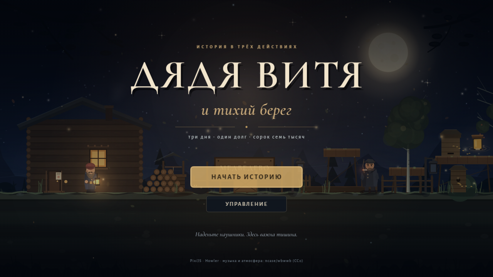
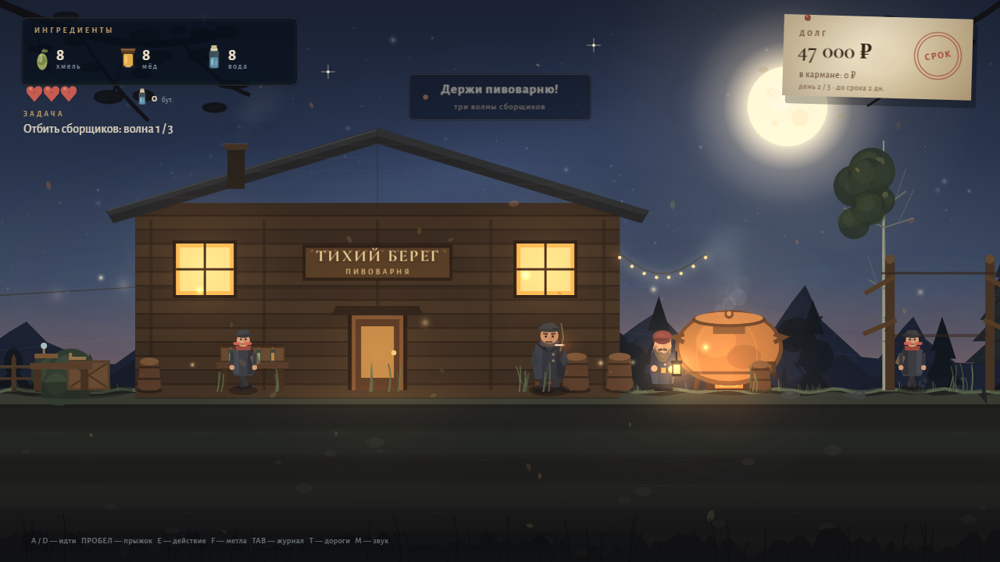
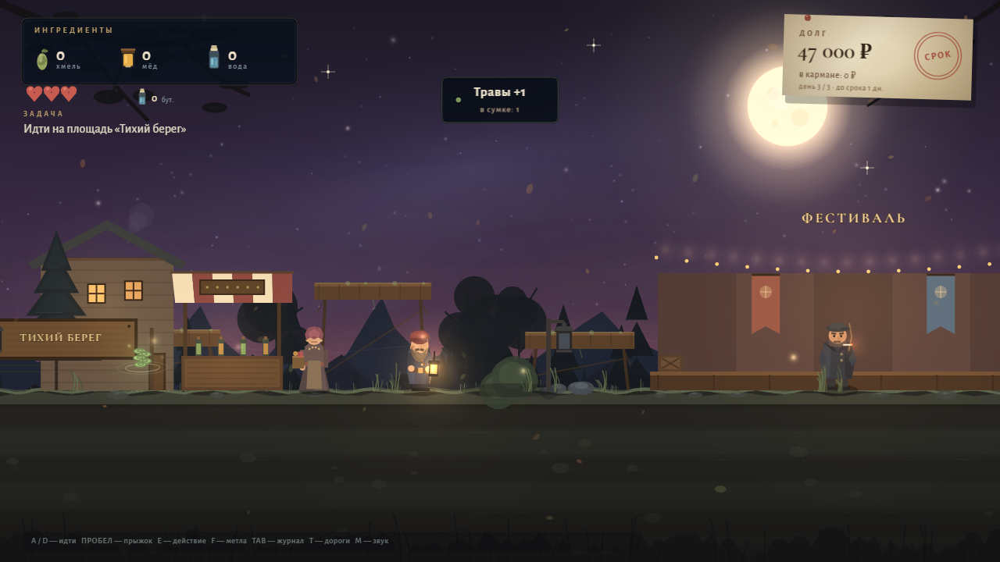
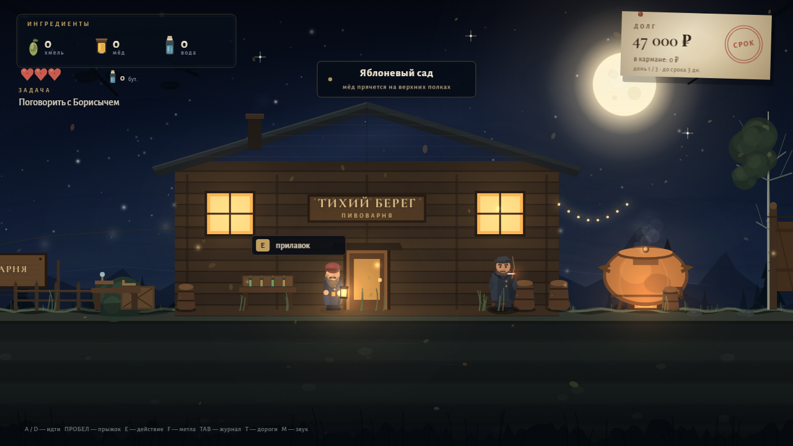
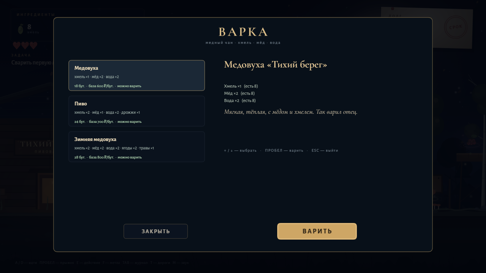

# Дядя Витя и тихий берег

**Атмосферная история в трёх днях: платформер, пивоварня, долги и один очень тихий берег.**  
Дядя Витя три года не пьёт, но должен Борисычу сорок семь тысяч. На двери — записка «Три дня». В сарае — отцовский медный чан, а в старой тетради — рецепт медовухи. Значит, пора варить.

**▶ Играть онлайн: [yakimak.github.io/dyadya-vitya](https://yakimak.github.io/dyadya-vitya/)**  
Играть можно прямо в браузере, скачивать ничего не нужно. Около 30–60 минут на одно прохождение.



## Что это теперь

- **Три дня — три главы.** Долг, старая мельница и деревенский фестиваль.
- **Один большой мир:** двор и огород, яблоневый сад, река, хмелевая роща, пивоварня, лесная дорога со старой мельницей и площадь «Тихий берег».
- **Экономика:** варите партии, продавайте бутылки, платите Борисычу, покупайте улучшения.
- **Мини-игра варки:** три этапа — огонь, хмель, мёд. Точность влияет на качество и цену.
- **Рецепты:** «Тихий берег», «Отцовское» и праздничный «Зимний берег».
- **Поручения:** огород с хмелем, счастливая блесна Стаса, фонарик Гриши, ночная оборона пивоварни.
- **Бой:** метла, сердца, вороны-воришки и сборщики Борисыча.
- **Развитие:** сапоги, медный котёл и фонарь отца.
- **Журнал:** Tab — задачи, рецепты, запасы, бутылки, репутация, улучшения.
- **Быстрые переходы:** T — дороги между знакомыми местами.
- **Автосохранение:** прогресс сохраняется в браузере; на титуле появляется «Продолжить».
- **Финалы немного отличаются** в зависимости от долга, репутации и выполненных поручений.









## Как играть

1. Соберите хмель, мёд и воду.
2. Сварите медовуху в медном чане.
3. Продайте бутылки у прилавка.
4. Отдайте Борисычу платёж.
5. Поспите дома — начнётся следующий день.
6. Слушайте людей: у каждого есть своя история и своё поручение.

Советы:

- **Tab** открывает дневник — там всегда видно, что делать дальше.
- **T** экономит дорогу, когда места уже открыты.
- Метла (**F**) пригодится в лесу и при обороне пивоварни.
- Вода для огорода берётся из колодца — поливать можно бесплатно.
- Если не хватает припасов для главного рецепта, поговорите с нужным человеком: вам помогут.
- Долг можно закрыть не идеально — финал это учитывает.

## Управление

| Клавиша | Действие |
|---|---|
| `A` / `D` или `←` / `→` | идти |
| `Пробел` / `W` / `↑` | прыжок |
| `E` / `Enter` | говорить, читать, варить, торговать |
| `F` / `J` | удар метлой |
| `TAB` | дневник и рецепты |
| `T` | быстрые переходы |
| `R` | вернуться к последнему фонарю |
| `ESC` | пауза |
| `M` | звук вкл/выкл |
| `V` | на весь экран |

## Запуск локально

### Windows

1. Установите Python 3, если его ещё нет.
2. Дважды щёлкните `start.bat`.
3. Браузер откроет `http://localhost:8000/`.

### Вручную

```bash
cd Game2
python -m http.server 8000
```

Затем откройте <http://localhost:8000/>.

> Запускайте через локальный сервер, а не двойным щелчком по `index.html`: при `file://` браузер может заблокировать звук и шрифты.

Рекомендуются Chrome, Edge или Firefox и наушники. Звук включается после первого клика — так требует браузер.

## Музыка и технологии

- **PixiJS 4.8.9** — рендер, сцены, свет.
- **Howler.js** — эмбиент и звуковые сэмплы.
- **Web Audio API** — оригинальная генеративная музыка: пэды, бас, музыкальная шкатулка, реверберация, плюс синтезированные эффекты.
- Бесплатные атмосферные звуки: **ncase/wbwwb** (CC0).
- Шрифты **Cormorant Garamond** и **Alegreya Sans** — SIL OFL, Google Fonts.
- Вся графика нарисована кодом: избы, берёзы, река, мельница, площадь, персонажи, портреты и медный чан.

## Структура проекта

```
index.html          точка входа
css/style.css       экран загрузки и фон страницы
fonts/              локальные шрифты (Cyrillic + Latin)
lib/                PixiJS и Howler
audio/              эмбиент из wbwwb
js/data.js          рецепты, предметы, улучшения, дороги
js/utils.js         палитра, математика, текстуры, ввод
js/audio.js         музыка, эмбиент, звуки
js/art.js           мир, персонажи, портреты, мельница, площадь
js/world.js         уровень, параллакс, река, NPC, огород, свет
js/entities.js      Витя, NPC, фонари, ингредиенты, враги
js/ui.js            HUD, диалоги, варка, магазин, журнал, дороги
js/game.js          состояния, камера, физика, сюжет, сохранения
```

## Кредиты

- **PixiJS** — MIT.
- **Howler.js** — MIT.
- **ncase/wbwwb** — атмосферные звуки, CC0; спасибо Nicky Case и авторам звуков.
- **Cormorant Garamond** и **Alegreya Sans** — SIL Open Font License.
- Сюжет, персонажи, графика, музыка и код — оригинальные.

## Для разработчика

Отладочные сцены (в обычной игре не нужны, сохранения в debug-режиме отключены):

```
?debug=1&scene=play&x=1800&day=2
?debug=1&scene=brew&frames=10&freeze=1
?debug=1&scene=journal&freeze=1
?debug=1&scene=shop&freeze=1
?debug=1&scene=travel&freeze=1
?debug=1&scene=defense&frames=180&freeze=1
?debug=1&scene=ending&freeze=1
```

`freeze=1` останавливает время для скриншота, `frames=N` прокручивает N кадров.

---

*Три дня. Один берег. Одна история.*
